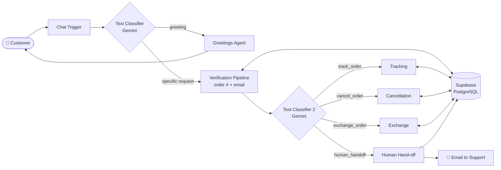
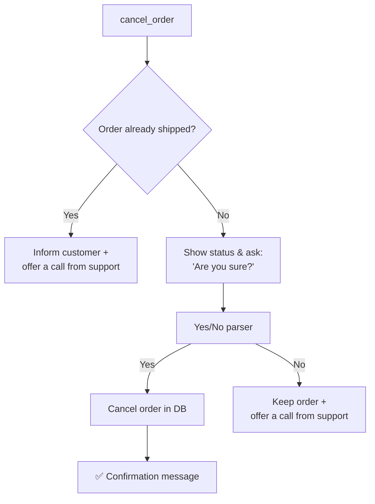
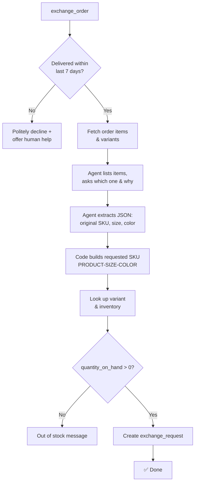
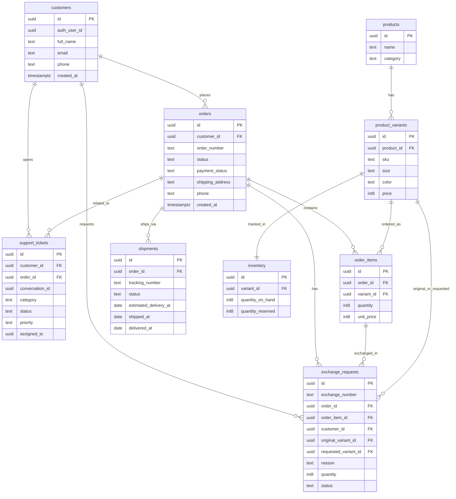

# 🛍️ Smart E-commerce Customer Support

> An AI-powered customer support chatbot built with **n8n**, **Google Gemini**, and **Supabase** that handles order tracking, cancellations, exchanges, and human hand-off — automatically and securely.


---

## 📑 Table of Contents

- [Overview](#-overview)
- [Key Features](#-key-features)
- [Architecture](#-architecture)
- [Workflow Details](#-workflow-details)
- [Database Schema](#-database-schema)
- [Tech Stack](#-tech-stack)
- [Getting Started](#-getting-started)
- [Example Conversations](#-example-conversations)
- [Project Structure](#-project-structure)
- [Known Limitations & Roadmap](#-known-limitations--roadmap)
- [Contributing](#-contributing)
- [License](#-license)
- [Author](#-author)

---

## 🔎 Overview

Customer support for online stores is repetitive: most tickets are *"Where is my order?"*, *"I want to cancel"*, or *"Can I swap this for a bigger size?"*. This project automates those conversations end to end.

The chatbot understands what the customer wants using LLM-based intent classification, **verifies their identity** (order number + email) before touching any data, performs the requested action against a live Supabase database, and **escalates to a human agent** whenever the request falls outside its scope.

---

## ✨ Key Features

| Feature | Description |
|---|---|
| 🧠 **Two-stage intent classification** | Gemini classifies the message first as *greeting / specific request*, then as *track / cancel / exchange / human hand-off*. |
| 🔐 **Customer verification** | Extracts the order number and email from free text, asks for anything missing, and confirms the email belongs to the order before any action. |
| 📦 **Order tracking** | Returns order status and estimated delivery date from the shipments table. |
| ❌ **Order cancellation** | Blocks cancellation of shipped orders, asks for explicit yes/no confirmation, then processes the cancellation. |
| 🔄 **Exchange requests** | Enforces a **7-day exchange window**, lists order items, extracts the desired size/color, maps it to a SKU, checks live inventory, and creates an exchange request. |
| 🙋 **Human hand-off** | Creates a support ticket, assigns it to an agent, and sends an email notification with the customer's phone number. |
| 💬 **Resilient conversation handling** | Retry loops for invalid order numbers / emails, and a robust yes/no parser that understands variations like *"nooo"*, *"nope"*, *"don't cancel"*. |

---

## 🏗️ Architecture



---

## ⚙️ Workflow Details

The entire logic lives in a single n8n workflow (`Smart_E-commerce_Customer_Support.json`), organized in clearly labeled sections.

### 1. 👋 Greeting & Intent Detection
1. A **Chat Trigger** receives the customer's message.
2. A **Text Classifier** (Gemini) labels it as `greeting` or `specified_question`.
3. Greetings are answered by a friendly **Greetings Agent**, and the conversation loops back for the real request.
4. Specific requests move on to verification.

### 2. 🔐 Order & Customer Verification
Runs before any sensitive action:

1. **Order number** — extracted from the message with a regex (supports `order 1043`, `#1043`, `ORD-1043`). If missing, the bot asks for it. If not found in the database, the bot asks the customer to retype it.
2. **Email** — extracted from the conversation, or requested "for your privacy". The email is looked up in `customers`, and its ID must match the `customer_id` on the order. Mismatches trigger a retry prompt.
3. Once verified, the order, customer, and shipment details are loaded for the next step.

### 3. 🎯 Request Routing
A second **Text Classifier** routes the verified customer to one of four branches:

| Category | Meaning |
|---|---|
| `track_order` | Ask about status, location, or delivery |
| `cancel_order` | Explicitly request cancellation |
| `exchange_order` | Swap an item for another size/color/product |
| `human_handoff` | Wants a human, refund, complaint, payment/damage issue, unsupported or unclear request |

### 4. 📍 Tracking Order
Replies with the customer's name, the order status, and the estimated delivery date.

### 5. 📍 Canceling Order

The yes/no parser normalizes input (case, emojis, repeated letters, punctuation) and matches many natural phrasings.

### 6. 📍 Exchange Order


**Structured extraction example** (output of the LLM + output parser):

```json
{
  "exchanges": [
    {
      "original_sku": "TS-M-BLK",
      "requested_size": "S",
      "requested_color": "Yellow"
    }
  ]
}
```

A Code node converts size and color names into SKU codes (e.g. `TS` + `S` + `YLW` → `TS-S-YLW`), so the LLM never has to guess database identifiers.

### 7. 📍 Human Hand-off
1. Creates a row in `support_tickets` (customer, order, status, assignee).
2. Sends an **email notification** to the support team containing the customer's name and phone number.
3. Tells the customer to expect a call within **10–15 minutes**.

---

## 🗄️ Database Schema

The backend is a **Supabase (PostgreSQL)** database with 8 related tables.




---

## 🧰 Tech Stack

| Layer | Technology |
|---|---|
| Workflow automation | [n8n](https://n8n.io) (LangChain nodes) |
| LLMs | Google Gemini (`gemini-2.5-flash-lite` for agents, `gemini-3.5-flash` for classifiers) |
| Database | [Supabase](https://supabase.com) (PostgreSQL) |
| Notifications | SMTP email (n8n *Send Email* node) |
| Interface | n8n Chat Trigger (embeddable chat widget) |

---

## 🚀 Getting Started

### Prerequisites
- An [n8n](https://docs.n8n.io/hosting/) instance (cloud or self-hosted)
- A [Supabase](https://supabase.com) project
- A [Google AI Studio](https://aistudio.google.com/) API key for Gemini
- An SMTP account (e.g., Gmail app password) for hand-off emails

### Installation

1. **Clone the repository**
   ```bash
   git clone https://github.com/<your-username>/smart-ecommerce-customer-support.git
   cd smart-ecommerce-customer-support
   ```

2. **Create the database**
   Create the 8 tables shown in the [schema](#-database-schema) in your Supabase project (SQL editor or table editor), then seed some sample customers, products, variants, inventory, orders, and shipments.

   > SKU convention used by the workflow: `PRODUCTCODE-SIZE-COLOR`, e.g. `TS-M-BLK` (T-Shirt, Medium, Black).

3. **Import the workflow**
   In n8n: **Workflows → Import from File** → select `Smart_E-commerce_Customer_Support.json`.

4. **Configure credentials**

   | Node(s) | Credential |
   |---|---|
   | All *Supabase* nodes | Supabase OAuth2 / API credential + your **project reference** |
   | All *Google Gemini Chat Model* nodes | Google Gemini (PaLM) API key |
   | *Send an Email* | SMTP credential, and update the `from` / `to` addresses |

5. **Customize business rules** *(optional)*
   - Exchange window: edit the `permitted exchange period` IF node (default: **7 days** after delivery).
   - Support assignee: edit the `assigned_to` field in the `Create a row` node.
   - Supported colors/sizes: edit the maps in the `requested SKU` Code node.

6. **Activate the workflow** and open the chat via the **Chat Trigger** URL (or embed it on your site).

---

## 💬 Example Conversations

**Tracking**
```
Customer: Where is my order 1043?
Bot:      For your privacy, please provide the email address associated with your order...
Customer: sara@example.com
Bot:      Hi Sara, your order ORD-1043 status is now in transit, estimated delivered at 2026-10-25.
```

**Exchange**
```
Customer: I want to exchange my T-shirt, order ORD-1043
Bot:      (verifies identity) Here are your items:
          1) T-Shirt | Size: M | Color: Black | 350 EGP
          Which item would you like to exchange, and why?
Customer: Size M is too big, I need S in yellow
Bot:      (checks inventory → creates exchange request) done
```

**Human hand-off**
```
Customer: I was charged twice for my order!
Bot:      Sure. I'll connect you with a customer service representative...
          Estimated call within 10 to 15 mins.
```

---

## 📁 Project Structure

```
smart-ecommerce-customer-support/
├── Smart_E-commerce_Customer_Support.json   # n8n workflow export
├── docs/
│   └── supabase-schema.png                  # Database diagram
└── README.md
```

---

## 🛣️ Known Limitations & Roadmap

This is a working prototype; the following improvements are planned or recommended before production use:

- [ ] **Soft-cancel orders** — set `status = 'cancelled'` instead of deleting the order row, to preserve history and audit trails.
- [ ] **Harden the "shipped" check** — compare against normalized/lowercase status values from a fixed set.
- [ ] **Move secrets & identifiers to credentials/env vars** (support email, project ref, assignee).
- [ ] **Reserve inventory** on exchange creation (`quantity_reserved`) and handle multi-item exchanges in a single request.
- [ ] **Support all sizes in extraction** (the SKU mapper already handles XS and XXL).
- [ ] **Row-Level Security (RLS)** policies in Supabase for production-grade data protection.
- [ ] **Multi-language support** (Arabic / English) and conversation memory across sessions.
- [ ] **Analytics dashboard** for ticket volume, exchange reasons, and resolution time.

---

## 🤝 Contributing

Contributions, issues, and feature requests are welcome!

1. Fork the project
2. Create your feature branch (`git checkout -b feature/amazing-feature`)
3. Commit your changes (`git commit -m "Add amazing feature"`)
4. Push to the branch (`git push origin feature/amazing-feature`)
5. Open a Pull Request

---

## 📄 License

Distributed under the **MIT License**. See `LICENSE` for more information.

---

## 👩‍💻 Author

**Your Name**
- GitHub: [@your-username](https://github.com/your-username)
- LinkedIn: [your-profile](https://linkedin.com/in/your-profile)

⭐ If you found this project useful, please consider giving it a star!
